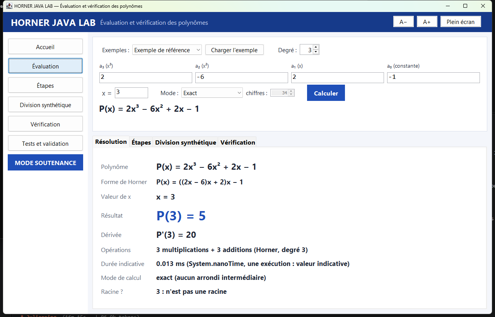

# HORNER JAVA LAB

**Implémentation, vérification et validation de l'algorithme de Horner en Java**
(cours de Vérification, Validation et Tests Logiciels).



## En bref

- Méthode de Horner écrite entièrement en Java (`BigDecimal`), sans bibliothèque externe pour le calcul.
- Évaluation simple et détaillée (trace réelle des étapes), dérivée en un seul parcours, division synthétique par (x − r).
- Oracle indépendant, tests par propriétés sur 500 cas aléatoires reproductibles, mode exact et mode précision contrôlée.
- Ligne de commande en français, interface Swing avec **MODE SOUTENANCE**.

## Résultats réels (2026-10-31, JDK Temurin 21.0.13, Maven 3.9.16)

| Mesure | Résultat |
|---|---|
| Tests (`mvn clean verify`) | **203 exécutés, 203 réussis, 0 échec, 0 ignoré** |
| Tests lourds (`mvn verify -Pheavy`) | 4 exécutés, 4 réussis |
| Couverture du moteur `core` | **99,6 % des instructions, 98,6 % des branches** |
| Couverture totale | 87,4 % des instructions, 78,2 % des branches (la GUI est mesurée séparément : 75,5 %) |

Le détail, y compris les défauts trouvés et corrigés, est dans [`docs/RAPPORT_DE_TESTS.md`](docs/RAPPORT_DE_TESTS.md).

## Convention

Les coefficients sont rangés par **puissances décroissantes** : `[2, -6, 2, -1]` représente P(x) = 2x³ − 6x² + 2x − 1.

## Démarrage rapide

```
mvn clean verify                                   # compile, teste, mesure la couverture, crée le JAR
java -jar target/horner-java-lab-1.0.0.jar         # interface graphique
Demarrer_Horner.bat                                # idem, par double-clic
java -jar target/horner-java-lab-1.0.0.jar eval --coeffs "2,-6,2,-1" --x 3              # P(3) = 5
java -jar target/horner-java-lab-1.0.0.jar derivative --coeffs "2,-6,2,-1" --x 3        # P'(3) = 20
java -jar target/horner-java-lab-1.0.0.jar divide --coeffs "2,-6,2,-1" --root 3         # Quotient : [2, 0, 2], Reste : 5
```

## Structure

```
src/main/java/org/hornerlab/
  Main.java                 point d'entrée (GUI sans argument, CLI sinon)
  core/                     Polynomial, HornerEvaluator, DerivativeEvaluator, SyntheticDivision,
                            NumericSettings, PolynomialFormatter, résultats (records)
  validation/               InputValidator, ReferenceEvaluator (oracle), ResultVerifier,
                            RandomPolynomialGenerator
  cli/                      CommandLineApp, ArgumentParser
  gui/                      HornerSwingApp, panneaux, GuiController (testable sans écran),
                            DemonstrationScript / DemonstrationPanel (mode soutenance)
  reporting/                TestReportService (campagne intégrée, lecture Surefire / JaCoCo),
                            BenchmarkService
  examples/                 ExampleLibrary (+ resources/examples/examples.csv)
docs/                       explication, pseudo-code, complexité, plan et rapport de tests, guides
reports/                    benchmark, campagne intégrée, captures de l'interface
```

## Documentation

- [Explication de Horner](docs/EXPLICATION_HORNER.md)
- [Pseudo-code et invariants](docs/ALGORITHME_PSEUDOCODE.md)
- [Complexité et mesures](docs/COMPLEXITE.md)
- [Plan de tests](docs/PLAN_DE_TESTS.md)
- [Rapport de tests](docs/RAPPORT_DE_TESTS.md)
- [Guide utilisateur](docs/GUIDE_UTILISATEUR.md)
- [Guide de soutenance](docs/GUIDE_SOUTENANCE.md)
